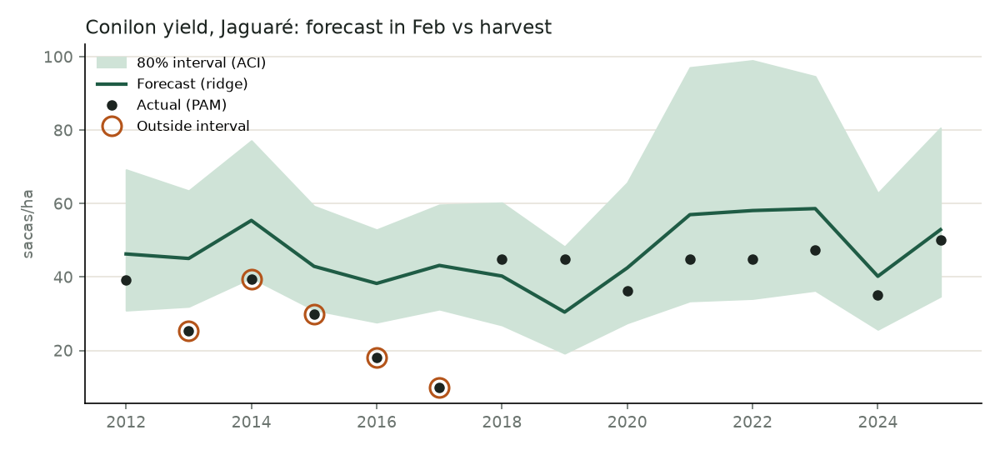
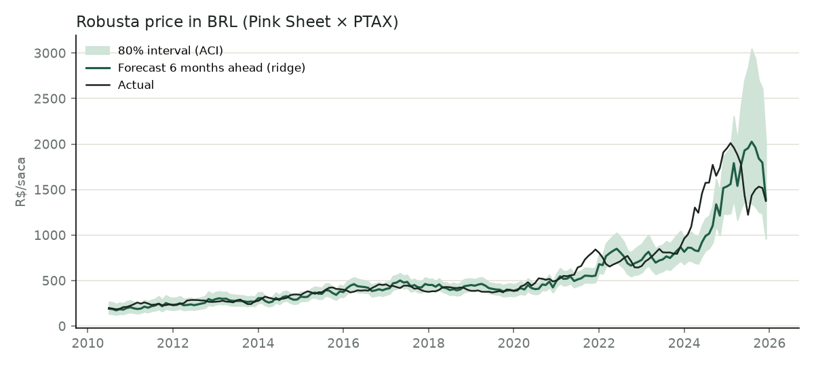
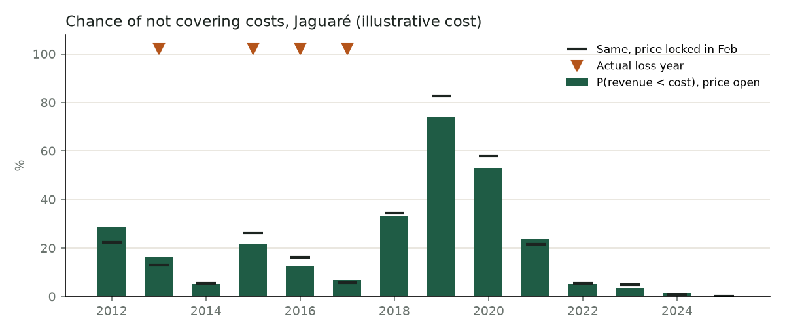
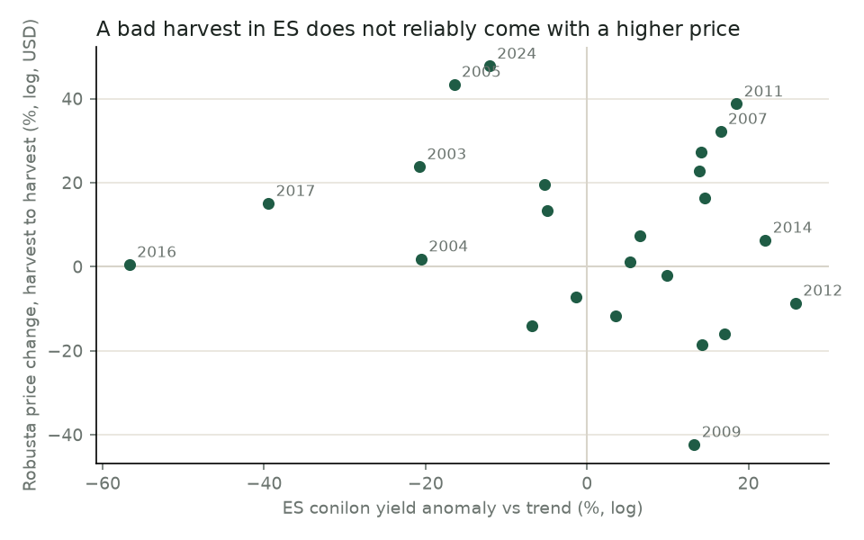
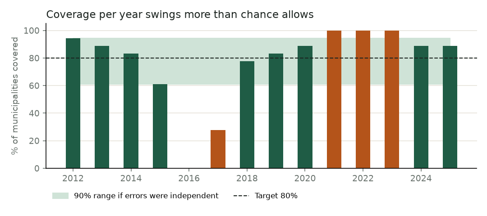
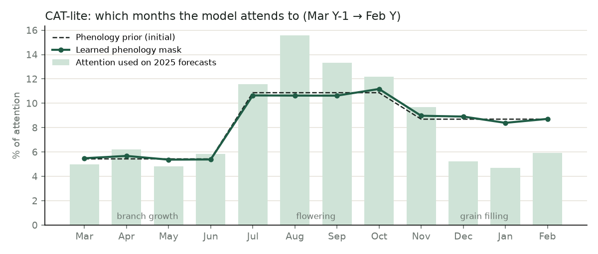
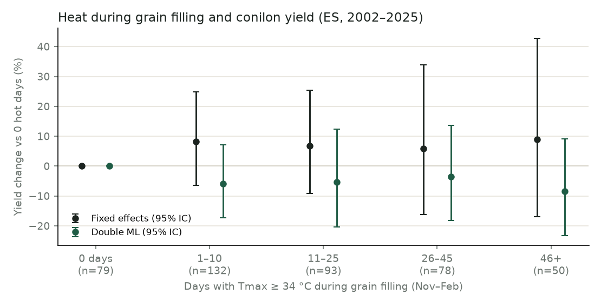

# Proof of concept: conilon yield, price and break-even

A first end-to-end test of the modelling idea on real data: forecast a
conilon farmer's yield and price with **calibrated 80% intervals**, then turn
them into the **chance of not covering costs**. Everything is backtested as if
forecasting in real time.

## Run it

```bash
python3 -m venv .venv && .venv/bin/pip install -r poc/requirements.txt
.venv/bin/python -m poc.fetch     # once: fills data/cio_da_terra.sqlite (~5 min)
.venv/bin/python -m poc           # backtests + writes poc/results/
.venv/bin/python -m poc --municipio Linhares --cost 25000
.venv/bin/python -m poc.experiments   # assumption tests (~2 min)
```

## Setup

| | |
|---|---|
| Crop and region | Conilon, 18 municipalities in northern Espírito Santo (`config.py`) |
| Yield data | IBGE PAM "café total" yield, 2002–2025 (mostly conilon there) |
| Weather | NASA POWER daily rain and temperature at each municipality's centroid |
| State estimates | IBGE LSPA monthly estimates for ES coffee, each vintage at its release date |
| Price | World Bank Pink Sheet robusta (USD/kg) × 60 × monthly PTAX → R$/saca |
| Forecast moment | End of February of harvest year Y (after flowering) |
| Intervals | Online split conformal + adaptive conformal inference (ACI), 80% |

**Point-in-time rules.** PAM for year Y-1 is only published around September
of Y, so a February forecast trains on years ≤ Y-2 and calibrates on errors
from years ≤ Y-2. Price models only learn from forecasts whose outcome month
has passed. This makes the scores worse than an in-sample fit, and honest.

**Filling the PAM gap with LSPA.** IBGE re-estimates each year every month
at state level. The database keeps every vintage with its release date, and
the model uses only those out before 1 March: the December estimate for Y-1
(mid-January) and IBGE's first estimate for Y (mid-February). LSPA reports
ES "café total" only up to 2017, so later years are rebuilt from arabica +
canephora production and area; the rebuilt series matches the published one
exactly for 2012–2016.

**Yield model.** log yield = municipality level + common linear trend
(clonal varieties, irrigation) + anomaly. The anomaly is modelled from rain
by crop stage, heat during grain filling, ENSO, the anomaly two years before
(clipped) and the two LSPA state anomalies. Models: trend only, ridge,
gradient boosting, small MLP.

**Price model.** 6-month-ahead log change from the last 12 monthly returns,
season and ENSO. Models: random walk, ridge, small MLP.

**Break-even.** Monte Carlo over the out-of-sample errors of the best yield
and price models, drawn independently, against an **illustrative** cost of
R$ 20,000/ha in 2025 reais deflated by IPCA. It also runs a "price locked in
February" scenario.

## Results

Full tables in [`results/summary.md`](results/summary.md).

**Yield**, 18 municipalities, forecast years 2012–2025:

| Model | MAE (sacas/ha) | Coverage of 80% interval (ACI) | Mean width (sacas/ha) |
|---|---|---|---|
| Trend only | 9.1 | 77.8% | 36.7 |
| Ridge | 8.9 | 77.4% | 32.7 |
| Gradient boosting | **8.5** | 80.6% | 32.2 |
| MLP (neural net) | 9.1 | 77.4% | 35.5 |

Without the LSPA features, gradient boosting had 9.1 and ridge 8.8: LSPA
helps the tree model, mostly in recent years (2025: 14.7 → 6.9 sacas/ha),
and not in the 2016 drought, which IBGE's own February estimate also missed
(29 sacas/ha first estimate, about 18 final).



**Price**, 6 months ahead, origins 2010–2025:

| Model | MAE (R$/saca) | Coverage (ACI) | Mean width (% of price) |
|---|---|---|---|
| Random walk | 91.7 | 76.9% | 38.8 |
| Ridge | **89.7** | 76.9% | 41.3 |
| MLP (neural net) | 118.1 | 79.6% | 56.9 |



**Break-even**, Jaguaré:



## What we learned

1. **Weather and state estimates add a modest, real gain.** The best model
   beats the trend baseline by about 0.6 sacas/ha, and shuffling the weather
   makes it worse in 98% of runs (experiment 3). ENSO carries most of it;
   IBGE's January estimate helps gradient boosting.
2. **The 2015–2017 drought is the failure case.** Nothing like it was in the
   training years, and it hit every municipality at once: coverage in 2016 was
   0–17%. Errors are correlated across municipalities within a year, so 80%
   coverage holds on average across years, not in each year.
3. **Price six months ahead is close to a random walk.** Ridge ties it, and
   the MLP is worse. The value is in the interval (about ±20%), not in the
   point forecast.
4. **Yield risk dominates the farmer's risk.** Locking the price in February
   barely changes the chance of not covering costs. That supports focusing
   the tool on yield protection (Proagro, insurance, Garantia-Safra) over
   price hedging, consistent with the "no natural hedge" argument.
5. **The break-even signal is not yet reliable.** For Jaguaré it gave 7–22%
   in the 2013–2017 loss years and 74% in 2019, a good year. The yield model
   is the weak link.
6. **The neural network meets the challenge requirement but doesn't win.**
   It needs a strong penalty to stay stable (alpha = 10; with 0.1 its MAE
   was 17) and then ties ridge on yield; on price it trails the random walk.

## Experiments: testing the main assumptions

`python -m poc.experiments` checks seven assumptions the project relies on.
Full tables and verdicts: [`results/experiments.md`](results/experiments.md).

| # | Assumption | Test | Result |
|---|---|---|---|
| 1 | No natural hedge | ES yield anomaly vs robusta price change, harvest to harvest | **Supported.** r ≈ −0.16, p ≈ 0.4 |
| 2 | Yield risk outweighs price risk | Out-of-sample error spread, revenue variance split | **Supported.** Yield ≈ 82% of variance |
| 3 | Weather adds real skill | Shuffle weather across years (200×); drop one group at a time | **Supported.** p ≈ 0.03; ENSO matters most (+1.0 sc/ha if dropped), rain +0.2 |
| 4 | Errors exchangeable across municipalities | Year share of error variance; per-year coverage vs binomial | **Not supported.** ~62% is a shared year shock; 5 of 14 years outside the range |
| 5 | PAM lag matters | Train on ≤ Y-1 (leaky) vs ≤ Y-2 | **Supported.** Leaky looks ~0.4 sacas/ha better |
| 6 | Weak biennial bearing | Anomaly autocorrelation at lags 1 and 2 | **Supported.** Lag-1 r ≈ 0.39, lag-2 ≈ 0.04: persistence, not alternation |
| 7 | PAM yields informative | Repeated and whole-number values | **Concern.** ~13% of years repeat; ~45% are whole sacas/ha |





What changes because of them:

- **Product focus.** Experiments 1 and 2 back the choice to centre the tool on
  yield protection (Proagro, insurance, Garantia-Safra) rather than price
  hedging.
- **Intervals.** Experiment 4 means "80%" is honest only on average across
  years. The model needs a shared year-shock term, and the UI should not
  present one municipality's interval as a guarantee for a given year.
- **Features.** Experiment 3 says the climate signal is real but mostly
  ENSO: next try water balance and irrigation. Experiment 6 pointed to last
  year's anomaly; it now comes from IBGE LSPA. In ridge the LSPA features
  barely move the error (−0.03 sacas/ha), and of the two, IBGE's first
  estimate for Y carries the weight, not the Y-1 estimate.
- **Honest reporting.** Experiment 5 shows why the backtest must keep the
  publication lag, even though it makes the numbers worse.

## Replicating the Climate-Adaptive Transformer (CAT)

[`cat_model.py`](cat_model.py) rebuilds the architecture of Namdeo &
Baraskar (2026) and [`cat.py`](cat.py) runs it as one more model in the same
backtest, with the same conformal + ACI intervals:

```bash
.venv/bin/pip install -r poc/requirements-cat.txt --extra-index-url https://download.pytorch.org/whl/cpu
.venv/bin/python -m poc.cat     # ~1.5 min on CPU → results/cat.md
```

| Paper | CAT-lite here |
|---|---|
| 12 months × 4 ERA5 variables | 12 months, Mar (Y-1) → Feb (Y) × tmax, tmin, rain, humidity (NASA POWER) |
| Phenology-aware positional encoding (sinusoidal + learned + harmonics) | same |
| Learnable phenology attention mask, initialised from crop physiology | same, initialised from conilon stages (growth, flowering, filling) |
| 4 layers, d = 128, 8 heads | 1 layer, d = 16, 2 heads (4,638 parameters), 3-seed ensemble |
| Cross-attention fusion with vegetation and static data, sigmoid gate | cross-attention with context tokens (ENSO, biennial lag, LSPA), sigmoid gate |
| Huber loss, AdamW, OneCycleLR, early stopping | same; early stopping on the latest known year |
| Split conformal + ACI | our online conformal + ACI |

No vegetation stream: the paper's own NDVI/EVI/LAI were proxies derived from
climate, so they add no information.

**Result**, same 18 municipalities and years as above
([`results/cat.md`](results/cat.md)):

| Model | MAE (sacas/ha) | Coverage (ACI) | Mean width (sacas/ha) |
|---|---|---|---|
| Trend only | 9.1 | 77.8% | 36.7 |
| Ridge | 8.9 | 77.4% | 32.7 |
| Gradient boosting | **8.5** | 80.6% | 32.2 |
| CAT-lite | 9.2 | 77.0% | 36.0 |



- **It doesn't beat the trend.** With ~430 rows (the paper had 7,182), even a
  4.6k-parameter Transformer overfits; it is worst in the 2016 drought
  (25 sacas/ha error).
- **The learned phenology mask stays at its prior.** There isn't enough data
  to move it, so the "learned" crop calendar is really the one we gave it.
- **Its attention is still informative:** on 2025 forecasts it puts ~53% of
  the weight on flowering (Jul–Oct), more than the prior, consistent with
  rain at flowering being the most useful rain feature in ridge.
- **Two implementation traps** worth knowing: a feature that is constant in
  training (LSPA before 2011) must keep scale 1 or predictions explode, and
  PyTorch's fused eval-mode attention returns NaN with a learned float mask
  (fast path disabled in `cat_model.py`).

**How it fits our run.** The paper's useful ideas are already in the
pipeline in a form that suits our data size: stage-based climate windows
(the phenology mask, as features), conformal intervals, ACI and a time-ordered
split. The Transformer itself is not worth its cost at municipal scale with
PAM. Keep it as a documented baseline, and revisit it if the data grows by
an order of magnitude: farm-level yields from cooperatives, or many more
regions and crops pooled together.

## Next step: causal inference

The models so far are **predictive**: they say what yield is likely, not what
would change if a farmer acted. The tool's "Proteções" and adaptation advice
need **causal** answers. Planned questions, from easiest to hardest:

| Question | Treatment | Method | Data still needed |
|---|---|---|---|
| How much does water stress at flowering cut yield, and does irrigation protect against it? | Rain deficit Jul–Oct (continuous dose) | Double ML with municipality and year effects; causal forest for heterogeneity by irrigated share | Irrigated share per municipality (Censo Agro 2017, ANA Atlas Irrigação) |
| How much does heat during grain filling cost? | Days ≥ 34 °C, Nov–Feb | Same, dose–response curve with its IC | none beyond the PoC |
| Does insurance/Proagro uptake stabilise income? | Share of area insured (PSR) or under Proagro | Double ML / difference-in-differences across municipalities and years; selection is the main threat | MAPA SISSER policies, BCB SICOR (Proagro) by municipality |

Why weather first: conditional on place and season, weather is as good as
random, so its effects are identifiable with this panel; insurance uptake is
chosen by farmers and needs a more careful design. Experiment 4's year shock
means errors must be clustered by year in any causal estimate. Double ML is
implemented directly in the PoC (no extra library); `DoubleML` or `econml`
can replace it for causal forests (Chernozhukov et al., 2018; Wager & Athey,
2018 in the main README's references).

### Step 1 done: heat during grain filling

```bash
.venv/bin/python -m poc.causal_heat     # ~30 s → results/causal_heat.md
```

**Design.** Treatment: days with Tmax ≥ 34 °C, Nov (Y-1)–Feb (Y). Outcome:
log yield. Controls: municipality, common trend, rain in each crop stage,
ENSO. Mean temperature (the treatment in another unit) and the LSPA estimates
(which may already reflect the heat) are left out on purpose. Estimators:
fixed-effects regression and double ML (gradient-boosting nuisances,
cross-fitted by year, repeated 5×), both with errors clustered by year.

| Specification | Effect per extra hot day | 95% IC |
|---|---|---|
| Fixed effects | −0.03% | [−0.49%, +0.43%] |
| Double ML | 0.00% | [−0.68%, +0.69%] |
| *No rain controls (confounded)* | *−0.31%* | *[−0.72%, +0.10%]* |



**Result: no detectable effect of heat once drought is accounted for.**

- **Most of heat's apparent harm is drought.** Without the rain controls the
  estimate is 10× larger and negative; with them it is about zero. Rain in
  grain filling itself is worth about +2.6% yield per 100 mm.
- **The curve is flat within its uncertainty.** All dose bins include zero;
  fixed effects and double ML scatter on either side of it.
- **Robust to the usual checks:** thresholds of 32 and 35 °C, degree-days,
  dropping 2016, the 2015–2017 drought or 2024, and year fixed effects
  (+0.23%, p ≈ 0.08, the wrong sign for harm). The placebo, heat in the
  season *after* harvest, shows nothing, as it must.
- **But it is not proof that heat is harmless.** The lower bound, about
  −0.5% per day, still allows a ~20% loss in a 46+ day season. Heat and
  drought overlap (r ≈ −0.7), 75% of heat varies only between years (24
  clusters), and NASA POWER's ~50 km grid blurs local temperature.

**What it means for the tool.** Conilon's main climate risk in this data is
**water**, not heat on its own: messages and protection advice should lead
with drought (Proagro, Garantia-Safra, irrigation) and treat heat as a
signal of drought. Plausible agronomically (conilon is a lowland robusta,
more heat-tolerant than arabica, and often irrigated in northern ES), but to
be confirmed with better data.

**Next causal steps.** (1) The water-stress dose–response at flowering, with
irrigated share as the source of heterogeneity (causal forest), needs Censo
Agro / ANA irrigation data. (2) Finer temperature (ERA5-Land, ~9 km) to
tighten the heat estimate. (3) Insurance uptake, with SISSER/SICOR data.

## Limitations

- **PAM municipal yields are coarse:** values are often repeated across years
  (Jaguaré: 23, 23, 30, 30, 32, 32 … 45, 45, 45), which caps any model's
  accuracy.
- **Price is not the farmer's price:** Pink Sheet robusta is an international
  reference. CEPEA's conilon indicator, with local basis, is the right series.
- **The cost is illustrative.** Replace it with Conab production costs.
- No irrigation data, no water balance (rain minus evapotranspiration), and
  NASA POWER's grid is coarse (~50 km).
- Yield and price are drawn independently; FX risk is folded into the price.

## Next steps

- Water-balance features (ERA5 or CHIRPS + evapotranspiration) and a share of
  irrigated area per municipality.
- A common "year shock" term (or a state-level in-season estimate from IBGE
  LSPA / Conab) to handle the correlated errors behind the 2016 miss
  (experiment 4).
- Add Conab's coffee surveys (January and May) next to LSPA: an independent
  estimate of the same harvest, conilon-specific for ES. Done for LSPA.
- Municipal LSPA-style signals don't exist; a state shock term is the
  closest. Try LSPA for MG/RO when the PoC extends to other regions.
- CQR with quantile models, so intervals can be wider where the model is less sure.
- CEPEA conilon prices and Conab costs, then re-run the break-even.
