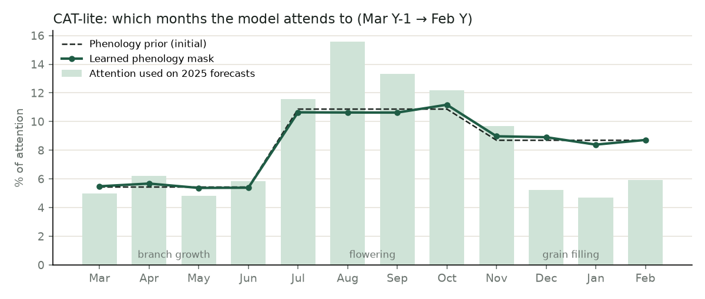

# CAT-lite vs PoC models

Generated by `python -m poc.cat`. Same rolling backtest and conformal/ACI intervals as the PoC; forecast years 2012–2025. CAT-lite: 4,638 parameters per network, 3-seed ensemble, ~432 rows in total.

| model   |   MAE (sc/ha) |   MAPE (%) |   Coverage 80% (fixed) |   Coverage 80% (ACI) |   Mean width ACI (sc/ha) |   Coverage in 2016 (ACI) |
|:--------|--------------:|-----------:|-----------------------:|---------------------:|-------------------------:|-------------------------:|
| trend   |           9.1 |       33.5 |                   75.8 |                 77.8 |                     36.7 |                        0 |
| ridge   |           8.9 |       29.7 |                   77   |                 77.4 |                     32.7 |                        0 |
| gbm     |           8.5 |       29.5 |                   81   |                 80.6 |                     32.2 |                        0 |
| cat     |           9.2 |       34   |                   76.6 |                 77   |                     36   |                        0 |

## Error by year (sacas/ha)

|   year |   cat |   gbm |   ridge |   trend |
|-------:|------:|------:|--------:|--------:|
|   2012 |   5.5 |   4.7 |     5.5 |     5.7 |
|   2013 |   7.8 |   7.9 |     6.6 |     7.4 |
|   2014 |   7   |   8.3 |     7.9 |     6.9 |
|   2015 |   8.6 |   5.7 |     9.2 |    10.7 |
|   2016 |  25.3 |  17.2 |    14.2 |    23.8 |
|   2017 |  16.9 |  13.3 |    13.7 |    15.5 |
|   2018 |   6.7 |   6.5 |    10.9 |     6.4 |
|   2019 |   8.4 |  11   |    11.5 |    10.9 |
|   2020 |   7   |   6.9 |     8.1 |     6.9 |
|   2021 |   4.8 |   8.3 |     6.1 |     7.4 |
|   2022 |   5.9 |   4.6 |     6.1 |     6.7 |
|   2023 |   6.3 |   9   |     6.9 |     4   |
|   2024 |  10   |   8.8 |     7   |     9.4 |
|   2025 |   9.1 |   6.9 |    10.4 |     6.3 |

## Attention by crop stage (last fit)

| stage     |   prior |   learned |   used |
|:----------|--------:|----------:|-------:|
| growth    |   0.217 |     0.219 |  0.219 |
| flowering |   0.435 |     0.431 |  0.526 |
| filling   |   0.348 |     0.35  |  0.255 |

