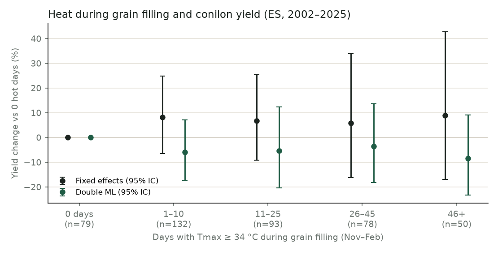

# Heat dose–response (causal step 1)

Generated by `python -m poc.causal_heat`. 432 municipality-years, 18 municipalities, 2002–2025; 95% IC use errors clustered by year (t with 23 df).

## Effect of one more hot day

| Specification                           |   Effect per hot day (%) |   95% IC low |   95% IC high |   p-value |
|:----------------------------------------|-------------------------:|-------------:|--------------:|----------:|
| Fixed effects (municipality + trend)    |                    -0.03 |        -0.49 |          0.43 |     0.894 |
| Double ML (gradient boosting nuisances) |                     0    |        -0.68 |          0.69 |     0.996 |

## Dose–response

| Hot days   |   Observations |   FE effect (%) | FE 95% IC   |   DML effect (%) | DML 95% IC   |
|:-----------|---------------:|----------------:|:------------|-----------------:|:-------------|
| 0 days     |             79 |             0   | reference   |              0   | reference    |
| 1–10       |            132 |             8.1 | [-6, 25]    |             -5.8 | [-17, 7]     |
| 11–25      |             93 |             6.7 | [-9, 25]    |             -5.4 | [-20, 12]    |
| 26–45      |             78 |             5.9 | [-16, 34]   |             -3.6 | [-18, 14]    |
| 46+        |             50 |             9   | [-17, 43]   |             -8.5 | [-23, 9]     |

## Robustness (fixed effects)

| Specification                               |   Effect per hot day (%) |   95% IC low |   95% IC high |   p-value |
|:--------------------------------------------|-------------------------:|-------------:|--------------:|----------:|
| No rain controls (confounded by drought)    |                    -0.31 |        -0.72 |          0.1  |     0.127 |
| Threshold 32 °C                             |                     0.07 |        -0.22 |          0.36 |     0.602 |
| Threshold 35 °C                             |                    -0.02 |        -0.58 |          0.55 |     0.94  |
| Degree-days above 34 °C (per °C·day)        |                     0.02 |        -0.15 |          0.18 |     0.852 |
| Year fixed effects instead of trend         |                     0.23 |        -0.03 |          0.48 |     0.081 |
| Without 2016                                |                     0.09 |        -0.4  |          0.58 |     0.703 |
| Without 2015–2017 drought                   |                    -0.12 |        -0.55 |          0.31 |     0.569 |
| Without 2024                                |                    -0.06 |        -0.52 |          0.41 |     0.809 |
| Placebo: heat in the season *after* harvest |                     0.19 |        -0.09 |          0.46 |     0.179 |
| …same model, real heat                      |                    -0.01 |        -0.45 |          0.43 |     0.964 |
