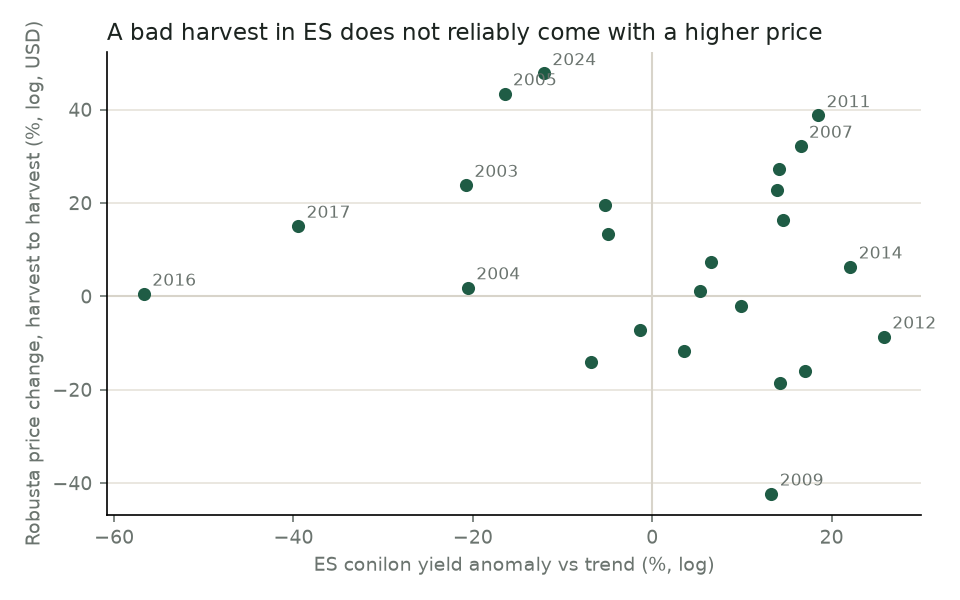
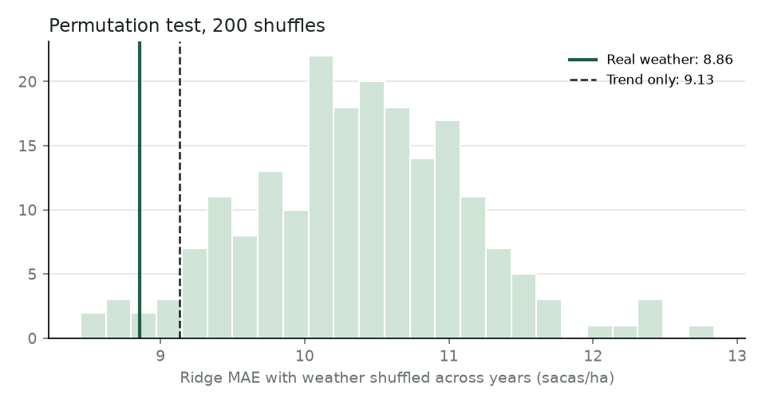
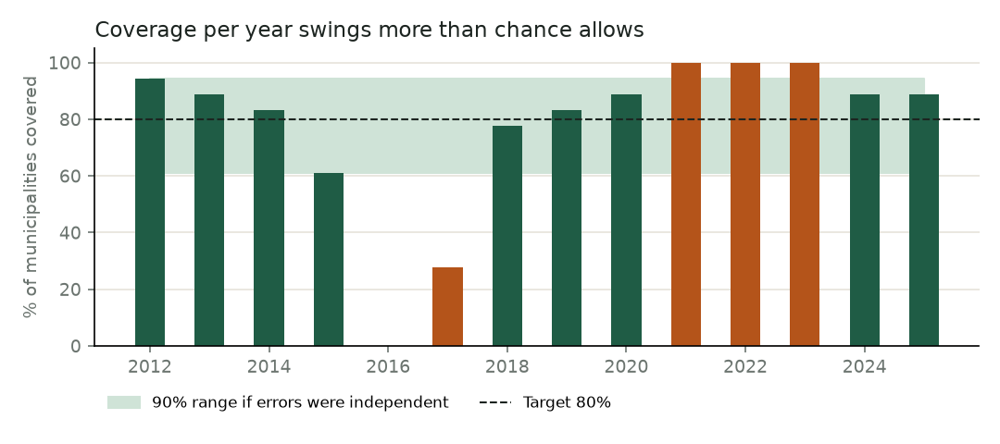

# Experiments: testing the main assumptions

Generated by `python -m poc.experiments` on the PoC data (18 conilon municipalities in Espírito Santo, forecast years 2012–2025). Verdicts are computed from the numbers.

## 1. No natural hedge

**Assumption.** A local yield loss is not compensated by a higher price, so farmers need yield protection.

**Test.** Correlate the median ES yield anomaly with the robusta price change between harvest seasons (May–Aug), in BRL and in USD. p-values from 10,000 permutations.

| Price    |   Years |   Pearson r |   Spearman ρ |   Permutation p |
|:---------|--------:|------------:|-------------:|----------------:|
| BRL/saca |      24 |      -0.171 |       -0.139 |           0.412 |
| USD/kg   |      24 |      -0.158 |       -0.143 |           0.465 |

**Verdict.** **Supported.** No significant link (r = -0.16, p = 0.47): a bad local harvest is not offset by a higher price.

## 2. Yield risk outweighs price risk

**Assumption.** For a February decision, the harvest is more uncertain than the price.

**Test.** Compare the out-of-sample log errors of the best yield model and of the 6-month random walk for price; revenue variance split assuming independence.

| Source                        |   Std of log error |   Share of revenue variance (independent) |
|:------------------------------|-------------------:|------------------------------------------:|
| Yield (ridge, Feb forecast)   |              0.337 |                                     0.823 |
| Price (random walk, 6 months) |              0.156 |                                     0.177 |

**Verdict.** **Supported.** Yield accounts for 82% of the revenue variance. In the break-even demo, locking the price in February changed the chance of not covering costs by 2.7 points on average.

## 3. Weather adds real skill

**Assumption.** Climate by crop stage improves the yield forecast beyond the trend.

**Test.** Permutation test: shuffle the weather and ENSO features across years (200 times, same shuffle for every municipality) and re-run the ridge backtest. Ablation: drop one feature group at a time.

|   MAE trend |   MAE ridge |   Median MAE, shuffled weather |   Permutation p |
|------------:|------------:|-------------------------------:|----------------:|
|       9.132 |       8.856 |                         10.397 |           0.025 |

| Features removed       |   MAE (sc/ha) |   Change vs full |
|:-----------------------|--------------:|-----------------:|
| none (full ridge)      |          8.86 |             0    |
| rain (3 stages)        |          9.08 |             0.22 |
| heat                   |          8.61 |            -0.24 |
| ENSO                   |          9.89 |             1.03 |
| biennial lag           |          8.71 |            -0.15 |
| LSPA (state estimates) |          8.83 |            -0.03 |
| all (trend only)       |          9.13 |             0.28 |

**Verdict.** **Supported.** Shuffled weather did as well as real weather in 2% of 200 runs.

## 4. Errors are exchangeable across municipalities

**Assumption.** Conformal intervals assume errors are exchangeable; pooling 18 municipalities per year treats them as 18 independent draws.

**Test.** Share of the ridge error variance explained by the year (one-way ANOVA), and per-year coverage against the 90% range of a Binomial(18, 0.8).

|   Error variance explained by the year | Years outside the 90% binomial range   | Expected if independent   |
|---------------------------------------:|:---------------------------------------|:--------------------------|
|                                   0.62 | 5 of 14                                | about 1.4                 |

**Verdict.** **Not supported.** 62% of the error is a shared year shock, so the 18 municipalities in a year behave more like one draw than 18. Coverage holds on average, not year by year.

## 5. Respecting the PAM publication lag matters

**Assumption.** Using yield data that would not be published yet makes results look better than they are.

**Test.** Re-run the backtest training on years ≤ Y-1 (leaky) instead of ≤ Y-2 (realistic).

| Setup                     |   MAE ridge (sc/ha) |   MAE trend (sc/ha) |   Coverage 80% (fixed) |   Mean width (sc/ha) |
|:--------------------------|--------------------:|--------------------:|-----------------------:|---------------------:|
| Realistic: train on ≤ Y-2 |                8.86 |                9.13 |                  76.98 |                30.93 |
| Leaky: train on ≤ Y-1     |                8.5  |                8.46 |                  75.4  |                27.53 |

**Verdict.** **Supported.** The leaky setup looks 0.36 sacas/ha better, an improvement a real February forecast could not have.

## 6. Biennial bearing is weak for conilon

**Assumption.** Unlike arabica, conilon yields do not alternate strongly between high and low years.

**Test.** Within-municipality correlation of yield anomalies (vs trend) at lags 1 and 2.

| Lag   |   Pairs |   Correlation |   p-value |
|:------|--------:|--------------:|----------:|
| lag1  |     414 |         0.387 |     0     |
| lag2  |     396 |         0.043 |     0.393 |

**Verdict.** **Supported: biennial bearing is weak.** Lag-1 r = 0.39, lag-2 r = 0.04. Anomalies persist rather than alternate (droughts last more than a year). PAM for Y-1 is not published by February, so the model takes this signal from IBGE LSPA instead (state estimates for Y-1 and the first estimate for Y; see the LSPA row of experiment 3's ablation). Part of the persistence may also come from PAM values repeated year to year (experiment 7).

## 7. PAM municipal yields are informative

**Assumption.** Yearly municipal yields from PAM measure what happened each year.

**Test.** Share of years whose yield equals the previous year's, and share of whole-number values.

|   Years equal to the previous year (median municipality) |   Worst municipality |   Yields that are a whole number of sacas/ha |
|---------------------------------------------------------:|---------------------:|---------------------------------------------:|
|                                                     0.13 |                0.261 |                                        0.447 |

**Verdict.** **Concern confirmed.** In the typical municipality, 13% of years repeat the previous value; 45% of values are whole sacas/ha. Part of the 'error' is measurement, not model.
